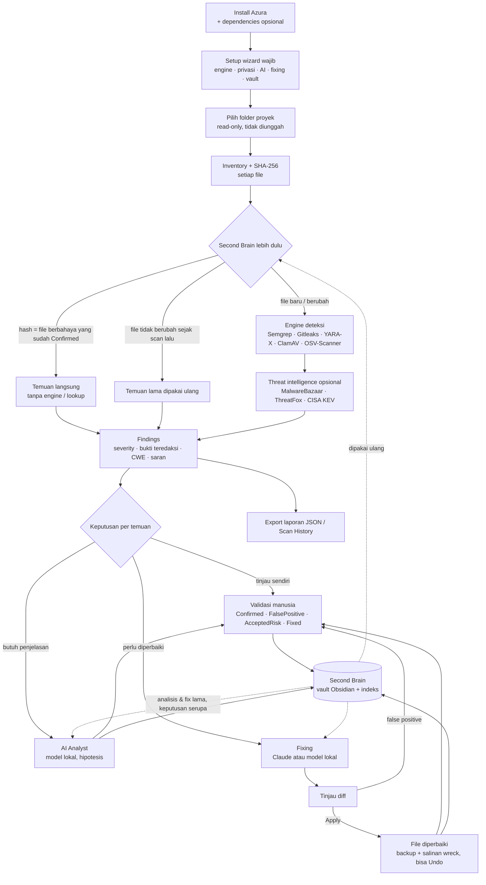

# Alur proses bisnis — Azura WebGuard Inspector

Azura membantu pengguna memeriksa keamanan source code di PC sendiri: file dibaca lokal, temuan diperiksa engine
deterministik, lalu manusia (dibantu AI) memutuskan dan memperbaiki. Semua pengetahuan disimpan di Second Brain agar
pemeriksaan berikutnya lebih cepat.

## Alur utama

## Tahapan

| # | Tahap | Siapa | Masukan | Keluaran | Aturan bisnis |
| --- | --- | --- | --- | --- | --- |
| 1 | Instalasi | Pengguna | Setup.exe | Aplikasi + Gitleaks, OSV-Scanner, YARA-X; opsional Semgrep, ClamAV, Claude Code, Obsidian, LM Studio | Per-user, tanpa hak admin |
| 2 | Setup wizard | Pengguna | Preferensi | `settings.json` | Wajib diselesaikan sebelum aplikasi dipakai; bisa diulang dari Settings |
| 3 | Pilih folder | Pengguna | Folder proyek | Ruang lingkup scan | File hanya dibaca; link/junction tidak diikuti; folder `wreck` dan folder build dikecualikan |
| 4 | Inventory | Sistem | Folder | Daftar file + SHA-256 | File > batas ukuran tidak di-hash |
| 5 | Second Brain lebih dulu | Sistem | Hash file, cache scan, vault | Temuan dari memori | File identik dengan file Confirmed berbahaya langsung ditandai; file tidak berubah tidak dikirim ke engine |
| 6 | Deteksi | Engine | File yang berubah | Temuan mentah | Engine gagal tidak menghentikan scan; versi/rule/signature baru → scan penuh; OSV selalu penuh |
| 7 | Intelligence | Sistem | Hash, paket | Temuan diperkaya | Hanya bila diizinkan di Privacy; hanya hash & nama paket yang dikirim, bukan kode |
| 8 | Findings | Pengguna | Temuan | Daftar terurut severity | Bukti selalu diredaksi; keputusan lama diterapkan otomatis (juga untuk file identik di proyek lain) |
| 9 | AI Analyst | Pengguna + AI lokal | Temuan + cuplikan teredaksi | Analisis (hipotesis) | Analisis lama ditampilkan dulu; AI tidak pernah menjadi satu-satunya dasar keputusan |
| 10 | Fixing | Pengguna + AI | Temuan + file teredaksi | Usulan edit + diff | Fix lama untuk rule sama dipakai dulu; tidak ada yang ditulis sebelum Apply; false positive hanya saran sampai dikonfirmasi; perintah lanjutan (mis. regenerasi lockfile) hanya ditampilkan |
| 11 | Apply / Undo | Pengguna | Usulan | File baru, backup, salinan `.wreck` | Backup di luar proyek; Undo ditolak bila file sudah berubah lagi |
| 12 | Validasi | Pengguna | Temuan | Status di Second Brain | Dipakai otomatis di scan berikutnya |
| 13 | Second Brain | Sistem | Scan, temuan, analisis, fix, keputusan | Catatan Obsidian + `.webguard/` | Secret diredaksi; teks pengguna di catatan tidak pernah ditimpa |
| 14 | Pemeliharaan | Pengguna | Settings → Updates / Components | Versi aplikasi, engine, signature terbaru | Unduhan diverifikasi SHA-256; installer berjalan hanya setelah konfirmasi |

## Peran

- **Pengguna (security reviewer / developer)** — memilih folder, memutuskan status temuan, meninjau dan menerapkan perbaikan.
- **Engine deteksi** — sumber temuan deterministik (bukan AI).
- **AI (model lokal atau Claude)** — menjelaskan dan mengusulkan perbaikan; selalu berupa hipotesis yang ditinjau manusia.
- **Second Brain (Obsidian)** — memori jangka panjang: riwayat, keputusan, analisis, fix; sumber pertama sebelum engine dan AI.
